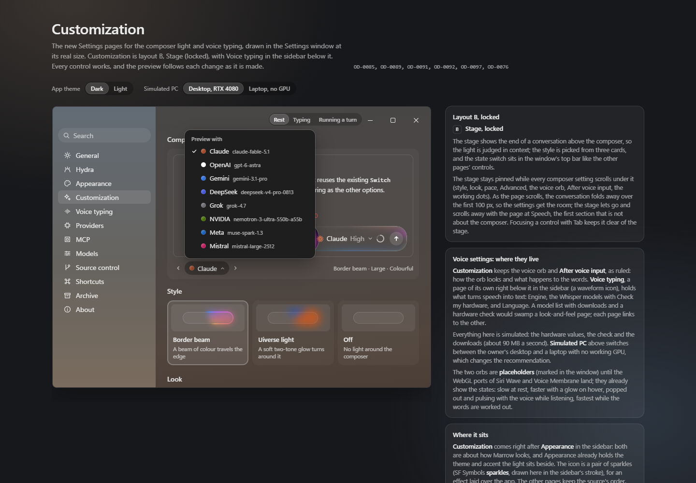
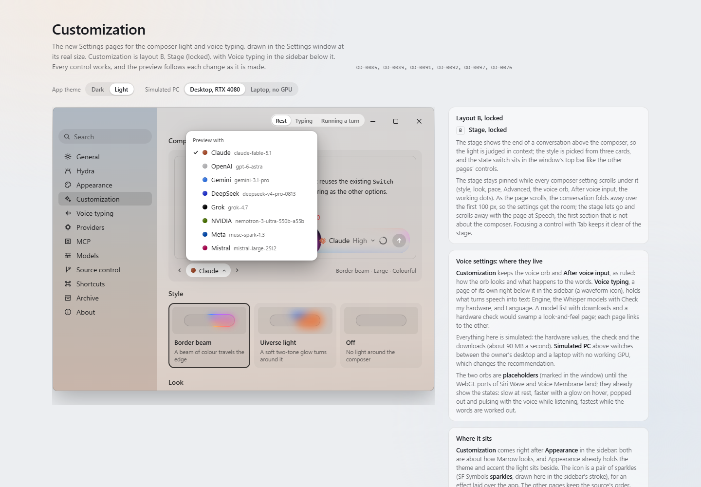

# GAP-2 Claude palette: appearance switch proved; decision pending

The owner requested both appearances of the locked Customization page in local Chrome, and ruled that neither palette test changes if the design matches neither pair. Both palette tests and all palette production remain unchanged.

Captured in Chrome 154.0.8037.99 on Windows at 1440 x 1000, DPR 1, fresh context per appearance. The page's own Theme radio switches the appearance; its Preview model button opens the menu. The original generated HTML is read-only, SHA256 `0997c5a520205079e2c7ad3e5c5bbab21a2c2aa3152e04bf96ebb8c855455349`. The capture uses the existing customization/tools/shot.cjs host skeleton, a local-only server, local Chrome/D3D11, and blocks external requests. The frozen PNGs are evidence, not replacements for an existing reference or tolerance.

## The switch took effect

| Witness | Dark | Light |
| --- | --- | --- |
| Page state / board | `dark() == true`, `cz dark` | `dark() == false`, `cz light` |
| Settings window | `czwin wd` | `czwin wl` |
| Composer slot style | `bbk-md-colorful-dark-h-f-g-w472 on` | `bbk-md-colorful-light-h-f-g-w472 on` |
| Page background at (1000,100), RGBA | (23,24,27,255) | (236,238,241,255) |
| Heading ink at (118,50), RGBA | (236,236,236,255) | (22,24,29,255) |
| Composer plate at (800,510), RGBA | (80,79,82,255) | (203,202,203,255) |

The composer has identical geometry (370,468; 472 x 52) but changes its theme-specific slot and pixels. This is not two dark-theme captures.

## Claude values

| Witness | Dark | Light |
| --- | --- | --- |
| Chip computed base | `rgb(161,72,39)` = `#A14827` | same |
| Menu dot computed base | `rgb(161,72,39)` = `#A14827` | same |
| Chip center (397,555), RGBA | (147,70,42,255) | (147,70,42,255) |
| Menu dot center (421,313), RGBA | (164,78,47,255) | (164,78,47,255) |
| Actual design model light pair | `#A14827`, `#D47E58` | `#A14827`, `#D47E58` |

Base CSS and screenshot pixels are reported separately: gen.py:366 draws the dot's white gradient and inset rim over its base. No sampled pixel is substituted for a palette stop.

The design `cz.js:156-160` returns toned deep/light stops in both appearances. `cz.js:167-169,183-188` selects the chip/menu deep stop; `gen.py:552-558` paints those dot elements. Generated HTML contains the Claude maker row `#A14827,#B95D3A,#D47E58,#E7B47E,#DA8563,#DA8563`.

The GAP equality requires composer dark `#CC6B47,#E0875F` and light `#B85A38,#CC6B47` (`ComposerLightSlot.cs:56-64`, `EffortSlider.cs:1597+`). PreviewMakersTests/CZ-4.5.5 requires maker dark `#B95D3A,#D47E58` and light `#A14827,#B95D3A` (`PreviewMakersTests.cs:102-110`, `PreviewMakers.cs:40-45`, customization-SPEC.md:274-279). The rendered design pair matches neither complete palette assertion. The dot demonstrates the liquid maker's deep stop, but cannot independently establish the light palette's mid-stop rule. Neither test is retired. Palette is the sole open item in the requested App GAP-2/Customization finish, pending the owner's decision.

## Frozen captures and reproducibility

`chrome-claude.json` records page state, DOM classes, computed colors, geometry, model values, exact pixel coordinates and PNG SHA256s. `render-claude.cjs` is the capture script. Run it with local Node and a new empty output directory: it refuses to overwrite either capture. The pinned HTML and existing design sources remain unchanged. This evidence makes no voice-orb or typography parity claim.
